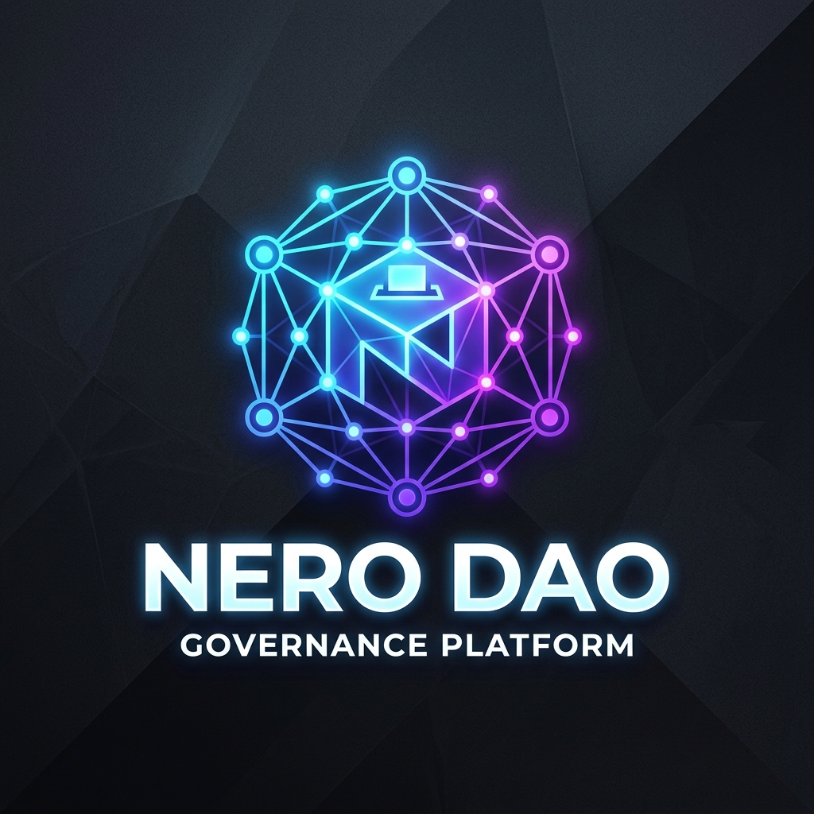

<div align="center">
  
</div>

# DAO Governance - Nero Chain

A decentralized autonomous organization (DAO) governance application migrated to the EVM-compatible Nero Chain. Submit proposals, cast weighted votes, and execute governance decisions through a modern, intuitive web interface.

## 🌟 Features

- **Submit Proposals**: Create governance proposals with customizable parameters including voting periods and categories
- **Weighted Voting**: Cast votes with configurable vote power on active proposals
- **Execute Governance**: Execute approved proposals or veto using governance authority
- **Real-time Status**: Track active proposals and wallet connection status
- **MetaMask Integration**: Seamless integration with MetaMask for secure transactions on Nero Chain
- **Responsive Design**: Modern UI with dark theme and smooth animations

## 🚀 Smart Contract Development

The project uses Hardhat for smart contract development and deployment.

### Prerequisites

- Node.js (v16 or higher)
- pnpm (recommended) or npm
- MetaMask wallet browser extension

### Installation

1. **Clone the repository**
   ```bash
   git clone <repository-url>
   cd nero-dao-voting
   ```

2. **Install dependencies**
   ```bash
   pnpm install
   ```

3. **Configure Environment**
   Update the `.env` file with your deployer wallet private key:
   ```env
   NERO_RPC_URL=https://rpc-testnet.nerochain.io
   PRIVATE_KEY=your_private_key_here
   ```

4. **Compile Smart Contracts**
   ```bash
   npx hardhat compile
   ```

5. **Deploy to Nero Testnet**
   ```bash
   npx hardhat ignition deploy ignition/modules/DaoVoting.js --network nero
   ```
   *After deployment, copy the deployed contract address and update `CONTRACT_ADDRESS` in `src/lib/nero.js`.*

### Frontend Setup

1. **Start the development server**
   ```bash
   pnpm dev
   ```

2. **Open in browser**
   - Navigate to `http://localhost:5173`
   - Connect your MetaMask wallet (ensure it's connected to Nero Testnet with Chain ID `689`)

## 📖 Usage

### 1. Connect Your Wallet
- Click "Connect Wallet" button
- Approve the connection in your MetaMask wallet

### 2. Submit a Proposal
- Go to "Submit Proposal" tab
- Fill in proposal details
- Click "Submit Proposal" and sign the transaction

### 3. Cast Your Vote
- Navigate to "Vote" tab
- Enter proposal ID and your vote power
- Select position: **FOR** ✓ or **AGAINST** ✗
- Cast Vote and sign the transaction

### 4. Execute or Veto
- Go to "Governance Actions" tab
- Execute an approved proposal or veto using governance authority

## 🔧 Technology Stack

- **Frontend**: React 19 with Vite
- **Blockchain**: ethers.js (`ethers`)
- **Smart Contracts**: Solidity (`0.8.24`)
- **Framework**: Hardhat
- **Wallet**: MetaMask (`window.ethereum`)

## 🌐 Network Information

**Network**: Nero Testnet  
**RPC URL**: `https://rpc-testnet.nerochain.io`  
**Chain ID**: `689`  
**Currency**: NERO

## 📝 License

This project is open source and available under the MIT License.
